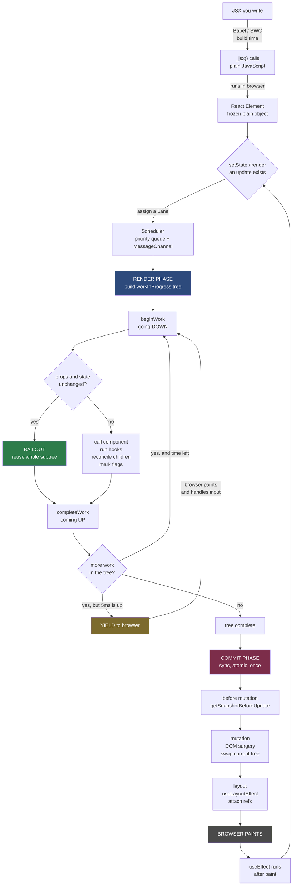
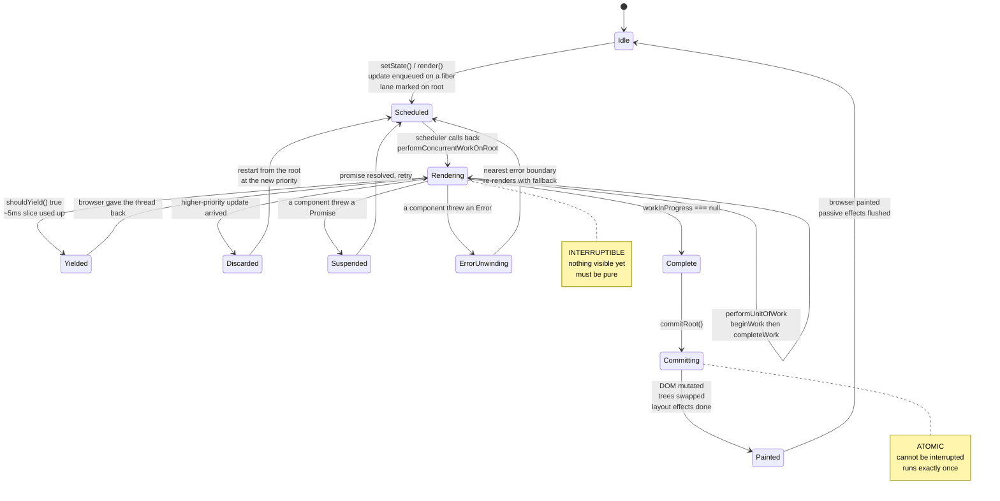

# 00 — The Big Picture: From Your JSX To Pixels On Screen

> The one diagram to hold in your head for the entire series.
> Every later topic is a zoom-in on one box here.
>
> [← master index](README.md)

---

## Part A — The whole journey, end to end

```
╔════════════════════════════════════════════════════════════════════════════╗
║  STAGE 0 — BUILD TIME  (your machine / CI. React is not running.)          ║
╚════════════════════════════════════════════════════════════════════════════╝

   You write JSX
   ┌────────────────────────────────────┐
   │ function App() {                   │
   │   const [n, setN] = useState(0)    │
   │   return <h1 onClick={…}>{n}</h1>  │
   │ }                                  │
   └──────────────┬─────────────────────┘
                  │   Babel / SWC / esbuild / tsc
                  │   (JSX is ERASED here — no browser understands it)
                  ▼
   Plain JavaScript
   ┌────────────────────────────────────────────────────┐
   │ import { jsx as _jsx } from "react/jsx-runtime"    │
   │ function App() {                                   │
   │   const [n, setN] = useState(0)                    │
   │   return _jsx("h1", { onClick: …, children: n })   │
   │ }                                                  │
   └──────────────┬─────────────────────────────────────┘
                  │
                  │  ════════ ships to the browser ════════
                  ▼

╔════════════════════════════════════════════════════════════════════════════╗
║  STAGE 1 — ELEMENTS  (runtime. `react` package. Topic 02)                  ║
╚════════════════════════════════════════════════════════════════════════════╝

   _jsx(...) runs  →  returns a frozen plain object. Nothing rendered yet.
   ┌─────────────────────────────────────────────┐
   │ {                                           │
   │   $$typeof: Symbol(react.…element),         │   ← XSS guard
   │   type:     "h1",                           │   ← string | fn | class | Symbol
   │   key:      null,                           │   ← reconciler metadata
   │   props:    { onClick: …, children: 0 }     │
   │ }                                           │
   └──────────────┬──────────────────────────────┘
                  │
                  │   createRoot(container).render(<App/>)
                  ▼

╔════════════════════════════════════════════════════════════════════════════╗
║  STAGE 2 — SCHEDULE  (scheduler + lanes. Topic 11)                         ║
╚════════════════════════════════════════════════════════════════════════════╝

   "An update happened. How urgent is it? When do we do the work?"
   ┌──────────────────────────────────────────────────────────┐
   │  assign a LANE (priority bitmask)                        │
   │     click / input      → SyncLane        (do it NOW)     │
   │     startTransition    → TransitionLane  (interruptible) │
   │     offscreen / idle   → IdleLane        (whenever)      │
   │                                                          │
   │  scheduleCallback(priority, performConcurrentWorkOnRoot) │
   │     └─ queued via MessageChannel, NOT setTimeout         │
   │        (setTimeout has a 4ms clamp; MessageChannel       │
   │         fires as a fresh macrotask with no delay)        │
   └──────────────┬───────────────────────────────────────────┘
                  │  browser's event loop eventually calls us back
                  ▼

╔════════════════════════════════════════════════════════════════════════════╗
║  STAGE 3 — RENDER PHASE  (react-reconciler. Topics 04–07)                  ║
║  ⚠ INTERRUPTIBLE · may run twice · may be thrown away · MUST BE PURE       ║
╚════════════════════════════════════════════════════════════════════════════╝

   Build a NEW fiber tree (workInProgress) by diffing against the old one.

   ┌───────────────── the work loop ─────────────────┐
   │ while (workInProgress && !shouldYield()) {      │   ← ~5ms slices
   │   workInProgress = performUnitOfWork(wip)       │
   │ }                                               │
   └─────────────────────────────────────────────────┘

        ──── going DOWN: beginWork(fiber) ────
        • call your component function (hooks run HERE)
        • get back child elements
        • reconcileChildren() → diff old fibers vs new elements
        • mark flags: Placement / Update / Deletion
        • or BAIL OUT and reuse the whole subtree

        ──── coming UP: completeWork(fiber) ────
        • create the real DOM node (not attached yet)
        • diff props → build an update payload
        • append already-built children to it
        • bubble effect flags up to the parent

   Result: a finished workInProgress tree + a list of what to change.
   ⚠ The screen has NOT changed at all yet.
                  │
                  ▼

╔════════════════════════════════════════════════════════════════════════════╗
║  STAGE 4 — COMMIT PHASE  (Topic 08)                                        ║
║  ⚠ SYNCHRONOUS · ATOMIC · CANNOT be interrupted · runs EXACTLY once        ║
╚════════════════════════════════════════════════════════════════════════════╝

   ┌─ 4a. BEFORE MUTATION ───────────────────────────────┐
   │    getSnapshotBeforeUpdate()                        │
   │    (read the DOM while it's still the OLD one)      │
   └────────────────────┬────────────────────────────────┘
   ┌─ 4b. MUTATION ─────────────────────────────────────┐
   │    appendChild / removeChild / setAttribute …      │
   │    useLayoutEffect CLEANUPS run                    │
   │    detach old refs                                 │
   │    ★ root.current = finishedWork  ← tree swap      │
   └────────────────────┬───────────────────────────────┘
   ┌─ 4c. LAYOUT ───────────────────────────────────────┐
   │    useLayoutEffect bodies run  (DOM is new,        │
   │      browser has NOT painted — blocking!)          │
   │    componentDidMount / componentDidUpdate          │
   │    attach new refs                                 │
   └────────────────────┬───────────────────────────────┘
                        ▼
╔════════════════════════════════════════════════════════════════════════════╗
║  STAGE 5 — BROWSER PAINT                                                   ║
╚════════════════════════════════════════════════════════════════════════════╝
            style → layout → paint → composite
                        │
                        ▼
            👁  the user finally sees it
                        │
                        ▼
            useEffect bodies run  (async, AFTER paint)
```

---

## Part B — The same thing as a flow chart



---

## Part C — The three trees, side by side

This is the single most useful mental model in the whole series.

```
   ELEMENTS                  FIBERS                      HOST INSTANCES
   "what I want"             "what React knows"          "what exists"
   ──────────────            ──────────────────          ─────────────────
   {type:'ul',               FiberNode{                  <ul>
    props:{children:[          tag: HostComponent,         <li>a</li>
      {type:'li',…},           type: 'ul',                 <li>b</li>
      {type:'li',…}            stateNode: <ul> ───────────►
    ]}}                        child: ──┐                </ul>
                               memoizedState,
                               flags, lanes,
                               alternate: ──┐
                             }             │
                                           ▼
                             (the other tree — Topic 05)

   immutable                 mutable, PERSISTENT         mutable
   recreated every render    survives across renders     touched only on diff
   cheap to allocate         holds ALL your state        expensive to touch
   thrown away instantly     identity = your identity    what the user sees
```

**Why this matters:** almost every confusing React behaviour is a question about
the **middle column**.

| Symptom | Real cause (middle column) |
|---|---|
| "My state reset for no reason" | The fiber was destroyed and recreated — different `type` or `key` at that position |
| "My input lost focus while typing" | The DOM node was unmounted and remounted, because its fiber was replaced |
| "My effect runs too often" | Dependencies are compared with `Object.is` against values stored on the fiber |
| "Two list items swapped their state" | Keys told the reconciler the wrong thing about identity |
| "My component didn't re-render" | A bailout — React decided nothing changed and reused the subtree |

---

## Part D — Where each package does its job

```
         YOUR CODE
             │
             ▼
   ┌───────────────────┐
   │      react        │  createElement / jsx, hooks (forwarders only),
   │                   │  Context, memo, lazy, Fragment
   │  ✗ cannot render  │
   └─────────┬─────────┘
             │ elements
             ▼
   ┌───────────────────────────────────┐        ┌──────────────────┐
   │       react-reconciler            │◄──────►│    scheduler     │
   │                                   │        │                  │
   │  THE ENGINE:                      │        │ priority queue   │
   │  • fiber tree + double buffering  │        │ MessageChannel   │
   │  • diffing / reconciliation       │        │ shouldYield()    │
   │  • hooks implementation           │        │                  │
   │  • lanes, Suspense, context       │        │ knows nothing    │
   │  • error boundaries               │        │ about UI         │
   │                                   │        └──────────────────┘
   │  host-agnostic — knows no DOM     │
   └─────────┬─────────────────────────┘
             │ calls ~30 primitive host operations
             ▼
   ┌─────────────────────────────────────────────────────────┐
   │  HOST CONFIG — pick one                                 │
   ├─────────────┬────────────┬───────────┬──────────┬───────┤
   │  react-dom  │react-native│ r3f       │   ink    │  pdf  │
   │  DOM nodes  │native views│Three.js   │ terminal │ pages │
   │  + synthetic│            │objects    │  boxes   │       │
   │    events   │            │           │          │       │
   │  + hydration│            │           │          │       │
   └─────────────┴────────────┴───────────┴──────────┴───────┘
```

> **Universal (reconciler):** keys, hooks, Suspense, batching, lanes, context
> **Web-only (react-dom):** `className`, `onClick`, hydration, `dangerouslySetInnerHTML`

---

## Part E — The state machine of a single update



---

## Part F — One concrete trace: `setCount(1)` on a click

Follow a single click all the way through. This is the whole library in 14 steps.

```
 1. User clicks <button>
 2. Browser fires a native 'click' on the ROOT container
        (react-dom delegates ALL events at the root, not per element)
 3. react-dom maps native event → SyntheticEvent, finds the target fiber,
        collects the handler path by walking `return` pointers up the tree
 4. Event priority = DiscreteEventPriority → SyncLane (most urgent)
 5. Your onClick runs → calls setCount(1)
        └─► dispatchSetState()
 6. An update object { lane, action: 1, next } is pushed onto that
        hook's circular update queue
 7. EAGER BAILOUT CHECK: if the new state === current state (Object.is),
        React returns immediately and schedules NOTHING
 8. Otherwise: mark SyncLane on the fiber, bubble the lane up every
        `return` pointer to the root, schedule work on the root
 9. ── RENDER PHASE ──
        clone root fiber → workInProgress
        beginWork: process the update queue, compute new state = 1,
                   call Counter() again, get new elements
        reconcileChildren: new <span>1</span> vs old <span>0</span>
                   → same type, same key → REUSE the fiber,
                     mark flags |= Update
        (siblings whose props are identical → BAILOUT, subtree untouched)
        completeWork: diff props → payload ['children', '1']
                      bubble the Update flag up to the root
10. Tree finished. React has a list of exactly what to change.
11. ── COMMIT PHASE ── (synchronous, no yielding)
        before mutation → nothing to do here
        mutation        → span.textContent = '1'
                          root.current = workInProgress   ★ TREE SWAP
        layout          → useLayoutEffect bodies, refs attached
12. Browser paints. User sees "1".
13. useEffect bodies are flushed (async, after paint).
14. Back to Idle. The two fiber trees have swapped roles and will be
        reused for the next update.
```

Notice step 7 and step 9's bailout: **most of React's performance comes from
work it decides not to do.**

---

## Part G — Reading map

| You want to understand… | Go to |
|---|---|
| Why React is 4 packages | [01 — Package architecture](part-1-what-react-is/01-package-architecture.md) |
| What `<div/>` actually is | [02 — JSX and Elements](part-1-what-react-is/02-jsx-and-elements.md) |
| Why Fiber exists at all | [03 — Stack → Fiber](part-1-what-react-is/03-stack-reconciler-to-fiber.md) |
| What's inside a fiber | [04 — The Fiber node](part-2-fiber-engine/04-fiber-node.md) |
| The two-tree swap | [05 — Double buffering](part-2-fiber-engine/05-double-buffering.md) |
| Diffing and keys | [06 — Render phase](part-2-fiber-engine/06-render-phase.md) |
| Where DOM nodes get made | [07 — Complete phase](part-2-fiber-engine/07-complete-phase.md) |
| Effect firing order | [08 — Commit phase](part-2-fiber-engine/08-commit-phase.md) |
| Why hooks can't be in `if` | [09 — Hooks internals](part-3-state/09-hooks-internals.md) |
| Batching | 10 — Updates & batching *(pending)* |
| Time slicing, priorities | 11 — Scheduler & lanes *(pending)* |
| Suspense, transitions | 12 *(pending)* |
| Context, error boundaries | 13 *(pending)* |
| `onClick` internals | 14 — Event system *(pending)* |

Plain-English versions for interviews: [interview-prep/](interview-prep/)
