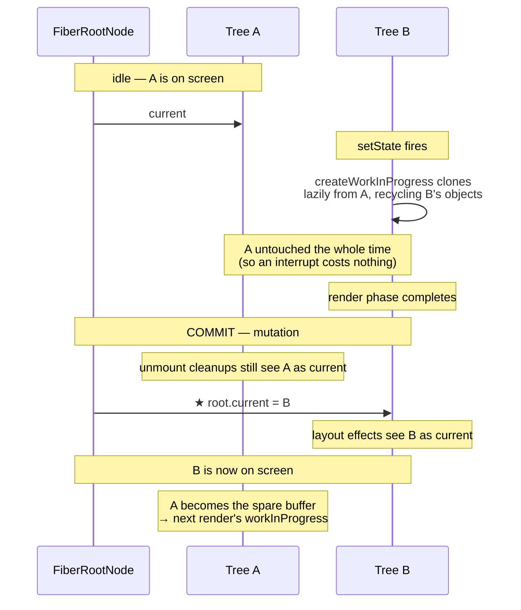

# 05 — Double Buffering: `current` vs `workInProgress`

> **Part 2 · Topic 5** — [index](README.md) · prev: [04 — The Fiber node](04-fiber-node.md) · next: 06 — Render phase

Topic 04 ended on one field: `alternate`. This topic is entirely about that field,
because it is the mechanism that makes everything in Topic 03 actually safe.

---

## The problem

We know from Topic 03 that the render phase can be **paused, resumed, or thrown
away entirely**. Now ask the obvious question:

> If React is building the new UI by **mutating the existing tree**, and then
> abandons the work halfway — what state is the tree in?

Corrupted. Half-old, half-new. And if the browser painted during one of those
yields, the user would see a half-updated screen — **tearing**.

```
   MUTATE-IN-PLACE (what React does NOT do)

   App ─ Header(new) ─ Main(new) ─ List(OLD) ─ Footer(OLD)
                                   ▲
                      interrupted here. Now what?
                      • can't paint — inconsistent
                      • can't undo — old values are gone
                      • can't resume safely — no record of what changed
```

You cannot have interruptible rendering and in-place mutation at the same time.

---

## The solution, borrowed from graphics

Video games and GPUs solved this decades ago: **double buffering**.

```
   FRONT BUFFER          BACK BUFFER
   (on the monitor)      (being drawn)
   ┌──────────┐          ┌──────────┐
   │ frame 41 │          │ frame 42 │  ← draw here, take your time
   └──────────┘          └──────────┘
        ▲                      │
        └──── swap pointers ◄──┘       ← instant, atomic
```

You never draw to the screen. You draw to a hidden buffer and then **flip a
pointer**. The viewer sees frame 41, then frame 42. Never a half-drawn frame.

React does exactly this with fiber trees.

---

## React's two trees

```
          FiberRootNode
          ┌─────────────────────┐
          │ current: ───────────┼────┐
          └─────────────────────┘    │
                                     ▼
      CURRENT TREE                        WORK-IN-PROGRESS TREE
      (what is on screen)                 (being built)

      ┌──────────┐      alternate      ┌──────────┐
      │ HostRoot │ ◄─────────────────► │ HostRoot'│
      └────┬─────┘                     └────┬─────┘
           │                                │
      ┌────▼─────┐      alternate      ┌────▼─────┐
      │   App    │ ◄─────────────────► │   App'   │
      └────┬─────┘                     └────┬─────┘
           │                                │
      ┌────▼─────┐      alternate      ┌────▼─────┐
      │ Counter  │ ◄─────────────────► │ Counter' │
      └────┬─────┘                     └────┬─────┘
           │                                │
      ┌────▼─────┐      alternate      ┌────▼─────┐
      │  <span>  │ ◄─────────────────► │  <span>' │
      └──────────┘                     └──────────┘
        stateNode ─────── SHARED ──────── stateNode
                   (both point at the SAME DOM node)
```

Two rules that make this work:

1. **`a.alternate === b` and `b.alternate === a`.** Always a pair, never a third.
2. **`stateNode` is shared.** Both fibers point at the *same* DOM node. Only one
   DOM tree exists — React keeps two bookkeeping trees over it.

---

## `createWorkInProgress` — the clone

This is the function that produces the other tree, one fiber at a time:

```js
function createWorkInProgress(current, pendingProps) {
  let workInProgress = current.alternate;

  if (workInProgress === null) {
    // ─── FIRST TIME: no alternate exists yet, allocate one ───
    workInProgress = createFiber(current.tag, pendingProps, current.key, current.mode);
    workInProgress.elementType = current.elementType;
    workInProgress.type        = current.type;
    workInProgress.stateNode   = current.stateNode;   // ← SHARE the DOM node

    // link the pair, both directions
    workInProgress.alternate = current;
    current.alternate = workInProgress;

  } else {
    // ─── EVERY TIME AFTER: RECYCLE the existing object ───
    workInProgress.pendingProps = pendingProps;
    workInProgress.type = current.type;

    // reset effects — this fiber is being reused from 2 renders ago
    workInProgress.flags = NoFlags;
    workInProgress.subtreeFlags = NoFlags;
    workInProgress.deletions = null;
  }

  // carry over everything from the current tree
  workInProgress.flags         = current.flags & StaticMask;
  workInProgress.childLanes    = current.childLanes;
  workInProgress.lanes         = current.lanes;
  workInProgress.child         = current.child;          // ← note this
  workInProgress.memoizedProps = current.memoizedProps;
  workInProgress.memoizedState = current.memoizedState;
  workInProgress.updateQueue   = current.updateQueue;
  workInProgress.dependencies  = current.dependencies;
  workInProgress.sibling       = current.sibling;
  workInProgress.index         = current.index;
  workInProgress.ref           = current.ref;

  return workInProgress;
}
```

### Three things to notice

**① After the first update, React allocates nothing.** The `else` branch recycles
the object that was the work-in-progress two renders ago. Two fiber objects per
component, reused forever. On a tree of 5,000 nodes, that's 10,000 objects total
instead of 5,000 fresh ones per render. The fiber tree is React's hottest data
structure; this is a deliberate GC decision.

**② `workInProgress.child = current.child`** — the clone is **shallow**. The new
fiber initially points at the **old** children.

**③ Children are cloned lazily**, only as `beginWork` descends into them.

That third point is the one that matters most.

---

## Lazy cloning is what makes bailouts nearly free

```
  Start of render — only the root is cloned:

      current          workInProgress
      ┌──────┐          ┌──────┐
      │ Root │◄────────►│ Root'│
      └──┬───┘          └──┬───┘
         │     ┌───────────┘
         ▼     ▼            ← both point at the SAME App fiber
      ┌──────────┐
      │   App    │
      └──────────┘
```

As `beginWork` walks down, it clones each child it touches. If it **bails out**
on a subtree, those fibers are never cloned — the new tree literally reuses the
old objects:

```js
function bailoutOnAlreadyFinishedWork(current, workInProgress, renderLanes) {
  if (!includesSomeLane(renderLanes, workInProgress.childLanes)) {
    return null;              // ← nothing below needs work.
                              //   Entire subtree shared, zero work, zero allocation.
  }
  cloneChildFibers(current, workInProgress);   // something below does — clone one level
  return workInProgress.child;
}
```

```
       Root'
      ╱     ╲
   Sidebar   Main'          ← Main had an update, so it was cloned
   (SHARED   ╱    ╲
    object)  Chart  Counter'
   ✂ never   (SHARED)  (cloned)
     cloned  ✂
```

**The unchanged parts of your UI aren't re-rendered, re-diffed, *or even copied*.
They are the exact same objects in both trees.** This is why React stays fast on
large trees where only a leaf changed.

---

## The flip

After the render phase finishes, `commitRoot` runs. One line in the middle is the
whole point of this topic:

```js
function commitRootImpl(root, ...) {

  commitBeforeMutationEffects(root, finishedWork);   // read old DOM

  commitMutationEffects(root, finishedWork, lanes);  // DOM surgery
                                                     // unmount cleanups see OLD tree

  root.current = finishedWork;                       // ★★★ THE FLIP ★★★

  commitLayoutEffects(finishedWork, root, lanes);    // layout effects see NEW tree
}
```

```
   BEFORE                             AFTER
   root.current ──► Tree A            root.current ──► Tree B
                    (on screen)                        (on screen)
                    Tree B                             Tree A
                    (just built)                       (now the spare —
                                                        becomes next render's WIP)
```

**One pointer assignment.** That is the entire "swap". The trees exchange roles;
the old current becomes the scratch buffer for the next render.

### Why the flip sits exactly there

It is placed between mutation and layout **on purpose**:

| Sub-phase | Needs `current` to be | Why |
|---|---|---|
| before-mutation | **old** tree | `getSnapshotBeforeUpdate` reads the pre-change DOM |
| mutation | **old** tree | `componentWillUnmount` / layout cleanups must see the tree they were created in |
| **← flip →** | | |
| layout | **new** tree | `componentDidMount` / `useLayoutEffect` / refs must see the new tree |

Move that line a few statements in either direction and lifecycle methods start
observing the wrong tree.

---

## `current === null` means "mount"

This is how React distinguishes mount from update, and it falls straight out of
double buffering:

```js
function beginWork(current, workInProgress, renderLanes) {
  //              ^^^^^^^ === workInProgress.alternate

  if (current === null) {
    // MOUNT — this fiber has no previous version
    mountIndeterminateComponent / mountState / mountEffect ...
  } else {
    // UPDATE — compare against current
    updateFunctionComponent / updateState / updateEffect ...
  }
}
```

So the one check `workInProgress.alternate === null` drives:

- whether `useState` **creates** a hook or **reads** the existing one
- whether `useEffect` runs unconditionally or compares dependency arrays
- whether React creates a DOM node or diffs props on an existing one
- whether `componentDidMount` or `componentDidUpdate` fires

And `current.memoizedProps` is literally where `prevProps` comes from in
`componentDidUpdate(prevProps, prevState)`.

---

## What you get from all this

| Capability | How double buffering provides it |
|---|---|
| **Abandon work for free** | Drop the WIP pointer. `current` was never touched. No undo needed. |
| **Atomic updates** | The user sees tree A or tree B, never a mix. No tearing. |
| **No allocation after first update** | Two objects per component, recycled forever. |
| **Cheap old-vs-new comparison** | `alternate` always holds the previous version. |
| **Mount vs update detection** | `current === null`. |
| **Near-free bailouts** | Untouched subtrees are *shared objects*, not copies. |

---

## The full cycle



---

## 🔧 Hands-on

```js
const el   = document.querySelector('#root > *');
const key  = Object.keys(el).find(k => k.startsWith('__reactFiber$'));
const f    = el[key];

f.alternate                        // the other version
f.alternate.alternate === f        // true — always a pair
f.stateNode === f.alternate.stateNode   // true — same DOM node, shared

// which tree am I holding?
let root = f; while (root.return) root = root.return;
root.stateNode.current === root    // true if this is the CURRENT tree
```

Trigger a state update, then run it again — the answer flips. You are watching
the buffers swap.

> ⚠ **Gotcha:** a fiber reference you saved in the console goes stale after the
> next commit. The live one may be `savedFiber.alternate`. The same trap exists
> inside React's own code, which is why the source is meticulous about naming
> variables `current` vs `workInProgress`.

---

## Key takeaways

- Interruptible rendering is impossible with in-place mutation, so React
  double-buffers — the same trick GPUs use for frames.
- Two trees, paired through `alternate`; **`stateNode` is shared**, so there is
  still only one DOM.
- `createWorkInProgress` **recycles** the alternate object — no allocation after
  the first update.
- The clone is **shallow**; children are cloned lazily, so **bailed-out subtrees
  are shared objects, not copies**.
- The swap is literally `root.current = finishedWork`, placed between the
  mutation and layout sub-phases so lifecycles observe the correct tree.
- `current === null` is how React knows mount from update — which drives hooks,
  effects, and lifecycle dispatch.

---

> next: **06 — Render phase**: `beginWork`, the diffing algorithm, keys, and the
> four bailout paths.
