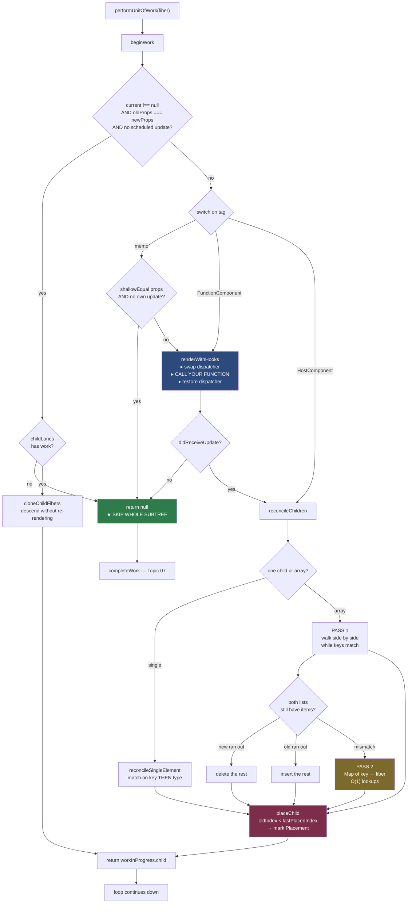

# 06 — The Render Phase: `beginWork`, Diffing, Keys, Bailouts

> **Part 2 · Topic 6** — [index](README.md) · prev: [05 — Double buffering](05-double-buffering.md) · next: 07 — Complete phase

The biggest topic in the series. This is where React decides **what changed**.

Everything here runs in the render phase, which means: **interruptible, may run
twice, may be thrown away, nothing visible happens.**

---

## Where we are

```
   performUnitOfWork(fiber)
         │
         ├──► beginWork(fiber)      ← THIS FILE: going DOWN
         │        returns child, or null
         │
         └──► completeWork(fiber)   ← Topic 07: coming UP
```

`beginWork` has exactly one job:

> **Given a fiber, produce its children — or decide you don't have to.**

---

## The shape of `beginWork`

```js
function beginWork(current, workInProgress, renderLanes) {

  // ── STEP 1: can we skip this entirely? ──────────────────
  if (current !== null) {
    const oldProps = current.memoizedProps;
    const newProps = workInProgress.pendingProps;

    if (oldProps !== newProps || hasLegacyContextChanged()) {
      didReceiveUpdate = true;                       // props changed by reference
    } else {
      const hasScheduledUpdate = checkScheduledUpdateOrContext(current, renderLanes);
      if (!hasScheduledUpdate && (workInProgress.flags & DidCapture) === NoFlags) {
        didReceiveUpdate = false;
        return attemptEarlyBailoutIfNoScheduledUpdate(current, workInProgress, renderLanes);
      }                                              //  ▲ THE BIG WIN
    }
  } else {
    didReceiveUpdate = false;                        // mount
  }

  // ── STEP 2: dispatch on tag ─────────────────────────────
  workInProgress.lanes = NoLanes;                    // consuming the work

  switch (workInProgress.tag) {
    case FunctionComponent:     return updateFunctionComponent(...);
    case ClassComponent:        return updateClassComponent(...);
    case HostRoot:              return updateHostRoot(...);
    case HostComponent:         return updateHostComponent(...);
    case HostText:              return null;          // ← leaf, no children
    case Fragment:              return updateFragment(...);
    case SimpleMemoComponent:   return updateSimpleMemoComponent(...);
    case SuspenseComponent:     return updateSuspenseComponent(...);
    case ContextProvider:       return updateContextProvider(...);
    // ...~25 cases
  }
}
```

Two halves: **try to skip**, then **do the work**.

---

## Part 1 — The four bailout paths

React's performance story is mostly "work it decided not to do". There are four
distinct escape hatches, at increasing cost.

```
┌──────────────────────────────────────────────────────────────────┐
│ ① EAGER STATE BAILOUT              cost: ~0                      │
│    setState(sameValue) → nothing is even scheduled               │
│    (happens in dispatchSetState — Topic 10)                      │
├──────────────────────────────────────────────────────────────────┤
│ ② EARLY BAILOUT + SUBTREE SKIP     cost: 1 comparison            │
│    oldProps === newProps (reference) AND no scheduled update     │
│    AND childLanes has nothing → return null, SKIP WHOLE SUBTREE  │
├──────────────────────────────────────────────────────────────────┤
│ ③ MEMO BAILOUT                     cost: shallow prop compare    │
│    memo(Comp) — props changed by reference but are equal by value│
├──────────────────────────────────────────────────────────────────┤
│ ④ POST-RENDER BAILOUT              cost: component DID run       │
│    Component ran, but state ended up the same → reuse old children│
└──────────────────────────────────────────────────────────────────┘
```

### ② Early bailout — and the subtree skip

```js
function attemptEarlyBailoutIfNoScheduledUpdate(current, workInProgress, renderLanes) {
  // (some tags need special handling here — context providers push their value,
  //  suspense re-checks its state, etc.)
  return bailoutOnAlreadyFinishedWork(current, workInProgress, renderLanes);
}

function bailoutOnAlreadyFinishedWork(current, workInProgress, renderLanes) {
  if (!includesSomeLane(renderLanes, workInProgress.childLanes)) {
    return null;        // ★ NOTHING below needs work at this priority.
                        //   Entire subtree skipped AND shared (Topic 05).
  }
  cloneChildFibers(current, workInProgress);   // something below does
  return workInProgress.child;                 // descend, but don't re-render me
}
```

This is `childLanes` from Topic 04 doing its job. Returning `null` from
`beginWork` means `performUnitOfWork` goes straight to `completeWork` — the
entire branch is never entered.

```
         App  (bailed out, but childLanes ≠ 0 → descend)
        ╱    ╲
   Sidebar    Main
   childLanes: 0        childLanes: Sync
   ✂ return null         ↓ keep going
   WHOLE BRANCH          ...
   NEVER VISITED
```

### Why `oldProps === newProps` is almost never true

It's a **reference** check. A parent re-rendering creates fresh JSX, so children
get brand-new props objects every time:

```jsx
<Child user={user} />     // new props OBJECT every render,
                          // even if `user` is the same reference
```

So path ② mostly fires for **bailed-out parents** (whose children were cloned
with the same props object) — not for ordinary re-renders. That gap is exactly
what `memo` fills.

### ③ `memo` — shallow compare

```js
function updateSimpleMemoComponent(current, workInProgress, Component, nextProps, renderLanes) {
  if (current !== null) {
    const prevProps = current.memoizedProps;
    if (shallowEqual(prevProps, nextProps) && current.ref === workInProgress.ref) {
      didReceiveUpdate = false;
      workInProgress.pendingProps = nextProps;

      if (!checkScheduledUpdateOrContext(current, renderLanes)) {
        workInProgress.lanes = current.lanes;
        return bailoutOnAlreadyFinishedWork(current, workInProgress, renderLanes);
      }
    }
  }
  return updateFunctionComponent(...);
}
```

Note the order: `memo` checks **value** equality where path ② checked
**reference** equality. And note the second condition — `memo` **cannot** skip a
component that has its own pending state update. Your own `setState` always wins.

> This is also why `memo` + inline object/arrow props does nothing:
> `shallowEqual` compares each prop with `Object.is`, and
> `{}` !== `{}`, `() => {}` !== `() => {}`. Hence `useMemo` / `useCallback`.

### ④ Post-render bailout

The component already ran, but nothing changed:

```js
function updateFunctionComponent(current, workInProgress, Component, nextProps, renderLanes) {
  const nextChildren = renderWithHooks(current, workInProgress, Component, nextProps, ...);

  if (current !== null && !didReceiveUpdate) {
    bailoutHooks(current, workInProgress, renderLanes);
    return bailoutOnAlreadyFinishedWork(current, workInProgress, renderLanes);
  }

  reconcileChildren(current, workInProgress, nextChildren, renderLanes);
  return workInProgress.child;
}
```

`didReceiveUpdate` is set to `true` inside the hooks machinery when a state value
actually changed. If you called `setState` with an equal value in a way that
slipped past the eager check, the function body runs but **its children are not
reconciled** — the old child fibers are reused as-is.

---

## Part 2 — `renderWithHooks`: where your component is called

```js
function renderWithHooks(current, workInProgress, Component, props, secondArg, nextRenderLanes) {
  currentlyRenderingFiber = workInProgress;        // module-level "who is rendering"

  workInProgress.memoizedState = null;             // reset the hooks list
  workInProgress.updateQueue   = null;
  workInProgress.lanes         = NoLanes;

  // ★ THE DISPATCHER SWAP
  ReactCurrentDispatcher.current =
    (current === null || current.memoizedState === null)
      ? HooksDispatcherOnMount       // useState CREATES hooks
      : HooksDispatcherOnUpdate;     // useState READS hooks

  let children = Component(props, secondArg);      // ◄── YOUR FUNCTION RUNS HERE

  // render-phase updates: setState called during render
  if (didScheduleRenderPhaseUpdateDuringThisPass) {
    let numberOfReRenders = 0;
    do {
      didScheduleRenderPhaseUpdateDuringThisPass = false;
      if (++numberOfReRenders > 25) {
        throw new Error('Too many re-renders. React limits the number of renders…');
      }
      ReactCurrentDispatcher.current = HooksDispatcherOnRerender;
      children = Component(props, secondArg);
    } while (didScheduleRenderPhaseUpdateDuringThisPass);
  }

  ReactCurrentDispatcher.current = ContextOnlyDispatcher;   // ← hooks now throw
  currentlyRenderingFiber = null;

  return children;
}
```

Four things worth marking:

1. **Your component is called on exactly one line.** Everything else in React is
   setup and teardown around that call.
2. **The dispatcher swap** is why `useState` behaves differently on mount vs
   update without you passing anything. Full detail in Topic 09.
3. **`ContextOnlyDispatcher` at the end** is what produces *"Invalid hook call"* —
   every hook on it just throws. Outside a render, the slot holds this.
4. **The 25 limit** is literally where *"Too many re-renders"* comes from. The
   `do/while` exists to support `setState` during render (the legitimate
   "derive state from props" pattern).

---

## Part 3 — Reconciliation: the diffing algorithm

`reconcileChildren` takes the new children elements and the old child fibers, and
produces new child fibers.

```js
function reconcileChildren(current, workInProgress, nextChildren, renderLanes) {
  if (current === null) {
    // MOUNT — no diffing needed, and no Placement flags on children
    workInProgress.child = mountChildFibers(workInProgress, null, nextChildren, renderLanes);
  } else {
    // UPDATE — diff
    workInProgress.child = reconcileChildFibers(
      workInProgress, current.child, nextChildren, renderLanes);
  }
}
```

> On mount React uses `mountChildFibers`, which is the *same function* with
> `shouldTrackSideEffects = false`. No child gets a `Placement` flag, because the
> parent is being inserted anyway — one insert instead of N.

### The complexity problem

Comparing two arbitrary trees optimally is **O(n³)**. For 1,000 nodes that's a
billion operations. Unusable.

React gets **O(n)** by making two assumptions, and accepting that they're
sometimes wrong:

> **Assumption 1 — Different types produce different trees.**
> If the element type at a position changed, don't try to match anything.
> Destroy the old subtree, build a new one.
>
> **Assumption 2 — The developer can mark stability with `key`.**
> React won't guess which list items moved; you tell it.

Plus one rule that follows from them:

> **Reconciliation never matches across levels or across parents.**
> Move a node to a different parent and it is destroyed and recreated — state
> lost, DOM node recreated — even if it looks identical.

### Assumption 1, demonstrated

```jsx
// render 1
<div><Counter /></div>

// render 2
<span><Counter /></span>
```

`div` → `span`, so React deletes the entire `div` subtree (including `Counter`
and all its state) and builds fresh. It does **not** notice that `Counter` is
identical.

#### The #1 real-world bug this causes

```jsx
function Parent() {
  // ❌ NEW FUNCTION IDENTITY EVERY RENDER
  function Child() { return <input />; }
  return <Child />;
}
```

Every render creates a new `Child` function. `oldFiber.elementType !== Child` →
different type → **delete and recreate**. Result: state resets, the `<input>` is
destroyed and rebuilt, **focus is lost on every keystroke**.

> Define components at module level. Always. This is the mechanism behind that rule.

#### The same mechanism as a feature

```jsx
<UserProfile key={userId} />
```

Change `userId` → different key → React deletes and remounts → **all state inside
resets**. The officially recommended way to reset a subtree.

---

## Part 4 — Single element: `reconcileSingleElement`

```js
function reconcileSingleElement(returnFiber, currentFirstChild, element, lanes) {
  const key = element.key;
  let child = currentFirstChild;

  while (child !== null) {
    if (child.key === key) {
      if (child.elementType === element.type) {        // ← MATCH
        deleteRemainingChildren(returnFiber, child.sibling);
        const existing = useFiber(child, element.props);  // REUSE the fiber
        existing.ref = coerceRef(returnFiber, child, element);
        existing.return = returnFiber;
        return existing;
      }
      deleteRemainingChildren(returnFiber, child);     // key matched, type didn't
      break;                                           // → give up, create new
    } else {
      deleteChild(returnFiber, child);                 // wrong key, drop it
    }
    child = child.sibling;
  }

  const created = createFiberFromElement(element, returnFiber.mode, lanes);
  created.return = returnFiber;
  return created;
}
```

The two-condition match — **`key` first, then `type`** — is the heart of
reconciliation. Both must agree or the fiber (and all its state) is thrown away.

---

## Part 5 — Arrays: the two-pass algorithm

This is the one people mean when they say "the React diffing algorithm".

### Pass 1 — walk both lists side by side while they agree

```js
let oldFiber = currentFirstChild;
let lastPlacedIndex = 0;
let newIdx = 0;

for (; oldFiber !== null && newIdx < newChildren.length; newIdx++) {
  const newFiber = updateSlot(returnFiber, oldFiber, newChildren[newIdx], lanes);
  if (newFiber === null) break;         // ◄── keys stopped matching. Bail to pass 2.

  if (shouldTrackSideEffects && oldFiber && newFiber.alternate === null) {
    deleteChild(returnFiber, oldFiber); // couldn't reuse → delete the old one
  }
  lastPlacedIndex = placeChild(newFiber, lastPlacedIndex, newIdx);
  // ...link into the new sibling chain
  oldFiber = oldFiber.sibling;
}
```

`updateSlot` returns `null` the moment the keys at that position differ. For the
common cases — appending to a list, changing one item's text, nothing moved —
**pass 1 handles everything and pass 2 never runs.**

### The two easy exits

```js
if (newIdx === newChildren.length) {
  deleteRemainingChildren(returnFiber, oldFiber);   // new list ran out → delete the rest
  return resultingFirstChild;
}

if (oldFiber === null) {
  for (; newIdx < newChildren.length; newIdx++) {   // old list ran out → insert the rest
    const newFiber = createChild(returnFiber, newChildren[newIdx], lanes);
    lastPlacedIndex = placeChild(newFiber, lastPlacedIndex, newIdx);
    // ...link
  }
  return resultingFirstChild;
}
```

### Pass 2 — the key map

Only reached if both lists still have items *and* they disagree — i.e. something
actually moved.

```js
const existingChildren = mapRemainingChildren(returnFiber, oldFiber);
// Map { key-or-index → fiber }

for (; newIdx < newChildren.length; newIdx++) {
  const newFiber = updateFromMap(existingChildren, returnFiber, newIdx, newChildren[newIdx], lanes);
  if (newFiber !== null) {
    if (shouldTrackSideEffects && newFiber.alternate !== null) {
      existingChildren.delete(newFiber.key === null ? newIdx : newFiber.key);
    }
    lastPlacedIndex = placeChild(newFiber, lastPlacedIndex, newIdx);
    // ...link
  }
}

// anything still in the map was not claimed → delete it
if (shouldTrackSideEffects) {
  existingChildren.forEach(child => deleteChild(returnFiber, child));
}
```

A `Map` makes each lookup O(1), so the whole pass is O(n). **This is why keys
exist** — without a key, the map is keyed by index, and index is exactly the
thing that changes when items move.

---

## Part 6 — `placeChild` and `lastPlacedIndex`

The move-detection logic. Small, and responsible for a real performance gotcha.

```js
function placeChild(newFiber, lastPlacedIndex, newIndex) {
  newFiber.index = newIndex;

  if (!shouldTrackSideEffects) return lastPlacedIndex;   // mount — nothing to move

  const current = newFiber.alternate;
  if (current !== null) {
    const oldIndex = current.index;
    if (oldIndex < lastPlacedIndex) {
      newFiber.flags |= Placement;        // ◄── THIS NODE MUST MOVE
      return lastPlacedIndex;
    }
    return oldIndex;                      // stays put; raise the high-water mark
  }
  newFiber.flags |= Placement;            // brand-new node → insert
  return lastPlacedIndex;
}
```

`lastPlacedIndex` is a **high-water mark**: the largest old-index placed so far.
The rule is *"a node only stays put if it was already to the right of everything
placed before it."*

### Consequence: moving to the END is cheap, moving to the FRONT is expensive

```
  [A, B, C]  →  [B, C, A]        (A moved to the end)

  B: oldIndex 1, 1 < 0? no  → lastPlacedIndex = 1
  C: oldIndex 2, 2 < 1? no  → lastPlacedIndex = 2
  A: oldIndex 0, 0 < 2? YES → Placement
                                        ✅ 1 DOM move
```

```
  [A, B, C]  →  [C, A, B]        (C moved to the front)

  C: oldIndex 2, 2 < 0? no  → lastPlacedIndex = 2
  A: oldIndex 0, 0 < 2? YES → Placement
  B: oldIndex 1, 1 < 2? YES → Placement
                                        ⚠ 2 DOM moves (optimal was 1)
```

```
  [A, B, C, D, E]  →  [E, A, B, C, D]   ⚠ 4 moves for one logical change
```

React's algorithm is **greedy and single-pass**, not optimal. It trades a little
DOM work for O(n) and simplicity. Worth knowing when you prepend to a long list —
the fibers and their state are all preserved correctly, but the DOM does more
work than strictly necessary.

---

## Part 7 — Why `key={index}` is a bug

Now the famous footgun, explained mechanically.

```jsx
{items.map((item, i) => <Row key={i} item={item} />)}
```

Insert `"New"` at the front of `["A","B","C"]`:

```
   OLD FIBERS                     NEW ELEMENTS
   key 0 → Row(item: A)           key 0 → Row(item: New)
   key 1 → Row(item: B)           key 1 → Row(item: A)
   key 2 → Row(item: C)           key 2 → Row(item: B)
                                  key 3 → Row(item: C)
```

Pass 1 matches **key 0 with key 0** — same key, same type → **reuse the fiber**,
just update props. Same for 1 and 2. Then key 3 is appended.

```
   Result:
   ✅ React thinks:  "nothing moved, 3 items changed props, 1 added"
   ❌ Reality:       "1 item added, nothing changed props"
```

Every row's props are rewritten, and — the real damage — **state stays with the
position, not with the item**:

| Fiber | Was showing | Now showing | Its state (checkbox, input, focus) |
|---|---|---|---|
| key 0 | A | New | **A's state, now on "New"** ❌ |
| key 1 | B | A | **B's state, now on "A"** ❌ |
| key 2 | C | B | **C's state, now on "B"** ❌ |

This is the classic "I checked row 1 and after adding an item the wrong row is
checked" bug. With `key={item.id}`, pass 1 breaks at index 0, pass 2 builds the
map, every fiber is matched to its real item, and only one `Placement` is emitted.

> **`key={index}` is safe only when the list is never reordered, never filtered,
> and items are only ever appended at the end.**

---

## Part 8 — The flags produced

By the end of `beginWork` on a parent, its children carry:

| Flag | Meaning | Set where |
|---|---|---|
| `Placement` | insert or move this node | `placeChild` |
| `Update` | props changed (payload computed in `completeWork`) | `completeWork` |
| `ChildDeletion` (on parent) + `deletions[]` | these children are gone | `deleteChild` |
| `Ref` | ref changed, re-attach | `markRef` |

Nothing has touched the DOM. These are notes for the commit phase.

---

## The whole render phase in one diagram



---

## 🔧 Hands-on

Watch a bailout happen:

```jsx
const Child = React.memo(function Child() {
  console.log('Child rendered');
  return <p>child</p>;
});

function Parent() {
  const [n, setN] = useState(0);
  console.log('Parent rendered');
  return <>
    <button onClick={() => setN(n + 1)}>{n}</button>
    <Child />                  {/* logs ONCE, ever */}
  </>;
}
```

Now break it — `<Child style={{}} />`. A new object every render, `shallowEqual`
fails, and `Child` logs on every click. That one line is the difference between
path ③ firing and not.

Watch `key` destroy state:

```jsx
const [k, setK] = useState(0);
return <>
  <button onClick={() => setK(k + 1)}>remount</button>
  <input key={k} defaultValue="type here" />
</>;
```

Type something, click. The DOM node is destroyed and rebuilt — assumption 1,
used deliberately.

---

## Key takeaways

- `beginWork` does one thing: **produce children, or decide not to.**
- **Four bailouts**, cheapest first: eager state → early reference check →
  `memo` shallow compare → post-render `didReceiveUpdate`.
- The early bailout + `childLanes` can **skip an entire subtree without entering it.**
- Your component is called on exactly one line, inside `renderWithHooks`, between
  a dispatcher swap — which is where "Invalid hook call" and "Too many re-renders"
  both come from.
- O(n) diffing rests on two assumptions: **different type → different tree**, and
  **`key` marks identity**.
- "Different type" is why defining a component inside render destroys state every
  render, and why `key={id}` is the idiomatic way to reset a subtree.
- Array diffing is **two passes**: a fast side-by-side walk, then a `Map` keyed by
  `key` only when something actually moved.
- `lastPlacedIndex` is a greedy high-water mark: **moving an item to the end is
  one move; moving one to the front moves everything else.**
- `key={index}` makes React match **positions instead of items**, so state follows
  the slot rather than the data.

---

> next: **07 — Complete phase**: where DOM nodes are actually created, how prop
> diffs are computed, and how flags bubble up.
