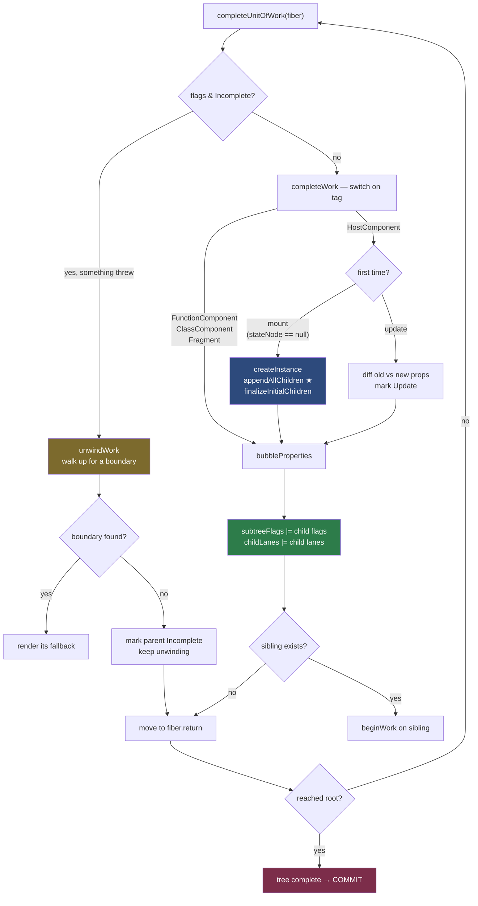

# 07 — The Complete Phase: Building DOM Bottom-Up

> **Part 2 · Topic 7** — [index](README.md) · prev: [06 — Render phase](06-render-phase.md) · next: 08 — Commit phase

Shorter than Topic 06, and it answers a question that's been hanging since
Topic 02: **where do DOM nodes actually get created?**

Answer: here. In the render phase. Before commit. Detached from the document.

---

## Where we are

`beginWork` goes **down**. `completeWork` goes **up**.

```
   performUnitOfWork(fiber)
      │
      ├─► beginWork(fiber) ──► returns child?
      │      │
      │      ├─ yes → descend, repeat
      │      └─ no  → this fiber is a leaf
      │
      └─► completeUnitOfWork(fiber)   ◄── THIS FILE
             │
             ├─► completeWork(fiber)
             ├─► sibling exists? → return it (beginWork on the sibling)
             └─► else → move to fiber.return and complete that
```

### The traversal is post-order

```
                 App ①↓                      ① beginWork  App
                 ╱      ╲                    ② beginWork  Header
          Header ②↓      Main ⑤↓             ③ beginWork  Logo (leaf)
            │             │                  ④ completeWork Logo
         Logo ③↓       List ⑥↓               ⑤ completeWork Header
            ④↑           ⑦↑                  ⑥ beginWork  Main
            ⑤↑           ⑧↑                  ⑦ beginWork  List (leaf)
                 ⑨↑                          ⑧ completeWork List
                                             ⑨ completeWork Main
                                             ⑩ completeWork App
```

**Every node is visited exactly twice** — once going down, once coming up.
That is the whole work loop.

> Why post-order? Because a parent cannot append children that don't exist yet.
> Children must be completed first. This single constraint dictates the design.

---

## `completeUnitOfWork` — the unwinding loop

```js
function completeUnitOfWork(unitOfWork) {
  let completedWork = unitOfWork;

  do {
    const current = completedWork.alternate;
    const returnFiber = completedWork.return;

    if ((completedWork.flags & Incomplete) === NoFlags) {
      // ── NORMAL PATH ──
      const next = completeWork(current, completedWork, renderLanes);
      if (next !== null) {
        workInProgress = next;      // completeWork produced more work (Suspense retry)
        return;
      }
    } else {
      // ── ERROR / SUSPENSE PATH ──
      const next = unwindWork(current, completedWork);
      if (next !== null) {
        next.flags &= HostEffectMask;
        workInProgress = next;      // found a boundary — render its fallback
        return;
      }
      // no boundary here: mark the parent incomplete too, and keep unwinding
      if (returnFiber !== null) {
        returnFiber.flags |= Incomplete;
        returnFiber.subtreeFlags = NoFlags;
        returnFiber.deletions = null;
      }
    }

    const siblingFiber = completedWork.sibling;
    if (siblingFiber !== null) {
      workInProgress = siblingFiber;   // go sideways
      return;
    }

    completedWork = returnFiber;       // pop a frame
    workInProgress = completedWork;
  } while (completedWork !== null);

  workInProgressRootExitStatus = RootCompleted;   // reached the root — done
}
```

Two paths through the same loop:

| Path | When | What it does |
|---|---|---|
| `completeWork` | normal | build host instances, diff props, bubble flags |
| `unwindWork` | a component **threw** | walk up looking for a boundary |

That second path is how **both** error boundaries and Suspense work. A thrown
`Error` or a thrown `Promise` sets `Incomplete`, and this loop walks up the
`return` chain until it finds a fiber that can handle it. If none exists, it
reaches the root and the whole render fails. (Detail in Topics 12–13.)

> This is the reified-stack idea paying off again: unwinding a *real* call stack
> needs `try/catch`. Unwinding React's stack is a `while` loop over pointers —
> which means it can be paused, resumed, and inspected.

---

## `completeWork` — the switch

```js
function completeWork(current, workInProgress, renderLanes) {
  const newProps = workInProgress.pendingProps;

  switch (workInProgress.tag) {

    case FunctionComponent:
    case ClassComponent:
    case Fragment:
      bubbleProperties(workInProgress);
      return null;                       // nothing host-related to do

    case HostComponent: {
      const type = workInProgress.type;

      if (current !== null && workInProgress.stateNode != null) {
        // ─── UPDATE ───
        updateHostComponent(current, workInProgress, type, newProps);
      } else {
        // ─── MOUNT ───
        const instance = createInstance(type, newProps, rootContainerInstance, ...);
        appendAllChildren(instance, workInProgress);          // ★
        workInProgress.stateNode = instance;
        if (finalizeInitialChildren(instance, type, newProps, ...)) {
          markUpdate(workInProgress);    // e.g. autoFocus needs a commit-time action
        }
      }
      bubbleProperties(workInProgress);
      return null;
    }

    case HostText: {
      const newText = newProps;
      if (current !== null && workInProgress.stateNode != null) {
        const oldText = current.memoizedProps;
        if (oldText !== newText) markUpdate(workInProgress);
      } else {
        workInProgress.stateNode = createTextInstance(newText, ...);
      }
      bubbleProperties(workInProgress);
      return null;
    }

    case HostRoot:          /* popHostContainer, hydration bookkeeping */
    case SuspenseComponent: /* may return a fiber → retry work */
    // ...
  }
}
```

Three jobs, every time: **make or update the host instance**, **compute what
changed**, **bubble a summary upward**.

---

## Job 1 — Mount: build the DOM tree off-screen

```js
const instance = createInstance(type, newProps, ...);   // document.createElement
appendAllChildren(instance, workInProgress);
workInProgress.stateNode = instance;
finalizeInitialChildren(instance, type, newProps, ...); // set initial props
```

### `appendAllChildren` — the piece that makes it bottom-up

```js
function appendAllChildren(parent, workInProgress) {
  let node = workInProgress.child;
  while (node !== null) {
    if (node.tag === HostComponent || node.tag === HostText) {
      appendInitialChild(parent, node.stateNode);     // a real DOM child — attach it
    } else if (node.child !== null) {
      node = node.child;                 // a component — look deeper for host nodes
      continue;
    }
    // ...walk siblings, then back up (stopping at workInProgress)
  }
}
```

It appends **host descendants**, skipping over function/class components, because
those have no DOM node of their own. `<Foo><div/></Foo>` puts the `div` directly
under `Foo`'s nearest host ancestor.

### What this produces

As completion walks up, each parent receives children that are already built:

```
  ④ completeWork(span)   → createElement('span')            <span>
  ⑤ completeWork(b)      → createElement('b')               <b>
  ⑥ completeWork(p)      → createElement('p')
                           appendAllChildren →               <p><span></span><b></b></p>
  ⑦ completeWork(div)    → createElement('div')
                           appendAllChildren →      <div><p><span/><b/></p></div>
                                                     ▲
                                        a complete DOM tree, DETACHED
                                        from document — nothing painted
```

Then at commit, **one** operation attaches the whole thing:

```js
container.appendChild(rootInstance);     // ← the entire initial UI, one insertion
```

```
     ┌──────────────────────────────────────┐
     │  RENDER PHASE (interruptible)        │
     │  build the whole DOM tree in memory  │
     │  0 reflows, 0 repaints, 0 visible    │
     └──────────────────┬───────────────────┘
                        ▼
     ┌──────────────────────────────────────┐
     │  COMMIT PHASE                        │
     │  ONE appendChild                     │
     │  → 1 reflow, 1 paint                 │
     └──────────────────────────────────────┘
```

> Creating a detached DOM node is cheap — no layout, no style recalc, no paint.
> Only *attachment* is expensive. React does all the creation in the throwaway
> phase and pays the expensive cost exactly once.
>
> Also: because these nodes are detached, abandoning a render costs nothing.
> The orphaned nodes are simply garbage collected.

---

## Job 2 — Update: compute the prop diff

For an existing host instance, nothing is created. React works out **what
changed**:

```js
function updateHostComponent(current, workInProgress, type, newProps) {
  const oldProps = current.memoizedProps;
  if (oldProps === newProps) return;        // bailed-out parent cloned us — nothing to do

  const updatePayload = prepareUpdate(instance, type, oldProps, newProps, ...);
  workInProgress.updateQueue = updatePayload;
  if (updatePayload) {
    markUpdate(workInProgress);             // flags |= Update
  }
}
```

### The payload is a flat array

`diffProperties` produces alternating key/value pairs:

```jsx
// before
<div className="box" title="old" onClick={a} />
// after
<div className="box" title="new" onClick={b} />
```
```js
updatePayload = ['title', 'new']
```

`className` is unchanged, so it's absent. `onClick` isn't in the payload either —
event handlers are stored on the fiber's props and looked up at dispatch time, so
there is nothing to write to the DOM. (Topic 14.)

Special cases `diffProperties` handles:

| Prop | Handling |
|---|---|
| `style` | diffed **key by key**; payload value is a partial style object `{color:'red'}` |
| `children` (string/number) | emitted as a text-content update, not a child fiber |
| `dangerouslySetInnerHTML` | compared by `__html` |
| `value` / `checked` | controlled-input special cases |
| `on*` | registered, never written as an attribute |

### Why diff here instead of at commit?

| | render phase | commit phase |
|---|---|---|
| interruptible | ✅ | ❌ |
| can be thrown away | ✅ | ❌ |
| blocks paint | no | **yes** |

Diffing is **pure computation** — safe to interrupt, safe to redo. So it belongs
in the phase that can absorb it. Commit should do the minimum: loop the array in
pairs and write.

**Diff in render. Apply in commit.**

> **React 19 note.** React 19 removed the render-phase `updatePayload` step from
> the host config — `completeWork` now just marks `Update` when props differ, and
> the property comparison happens inside `commitUpdate` with the old and new props
> directly. It avoids allocating a payload array per updated node. The
> architectural lesson is unchanged (one side computes, commit applies); only the
> seam moved. The 16–18 model above is the clearest way to understand *why* the
> separation exists.

### Text children: an optimisation worth knowing

```jsx
<div>hello</div>        // children is a string
```

React does **not** create a `HostText` fiber here. `shouldSetTextContent` returns
true, reconciliation skips creating a child, and the text becomes a prop set via
`textContent`. One fiber instead of two, one DOM node instead of two.

```jsx
<div>hello {name}</div>   // ← array of children, so HostText fibers ARE created
```

That is the real difference between those two JSX snippets.

---

## Job 3 — `bubbleProperties`: the summary

```js
function bubbleProperties(completedWork) {
  let subtreeFlags = NoFlags;
  let newChildLanes = NoLanes;

  let child = completedWork.child;
  while (child !== null) {
    newChildLanes = mergeLanes(newChildLanes,
                     mergeLanes(child.lanes, child.childLanes));

    subtreeFlags |= child.subtreeFlags;
    subtreeFlags |= child.flags;

    child.return = completedWork;      // (re-link, cheap insurance)
    child = child.sibling;
  }

  completedWork.subtreeFlags |= subtreeFlags;
  completedWork.childLanes = newChildLanes;
}
```

Both summary fields from Topic 04 are computed **right here**, on the way up:

- **`subtreeFlags`** → lets the *commit* phase skip branches
- **`childLanes`** → lets the *next render* skip branches

```
                App
          subtreeFlags: Update ▲
          childLanes: 0        │ bubbled up by bubbleProperties
         ╱                     │
   Header                     Main
   subtreeFlags: 0        subtreeFlags: Update ▲
   ✂ commit skips              │
     this branch              Text  flags: Update ●
```

It costs nothing extra — `completeWork` is already visiting every node on the way
up. That's the elegance of the React 18 change: the old flat effect list needed a
separate structure and separate allocation; this reuses a traversal that already
had to happen.

---

## The phase in one diagram



---

## 🔧 Hands-on

Prove the DOM is built before commit. Put a `debugger` in a deep child's render
and inspect — the parent DOM nodes above it do not exist yet, because their
`completeWork` hasn't run.

Easier: observe the single insertion.

```js
new MutationObserver(m => console.log('mutations:', m.length))
  .observe(document.getElementById('root'), { childList: true, subtree: true });
```

On initial mount of a large app you'll see **one** mutation record on the root
container, not one per element. The whole tree arrives pre-assembled.

---

## Key takeaways

- `completeWork` runs on the way **up**; every fiber is visited exactly twice.
- Post-order is forced by one fact: **a parent cannot append children that don't
  exist yet**.
- **DOM nodes are created in the render phase**, detached from the document.
  Creation is cheap; only attachment is expensive.
- `appendAllChildren` assembles each subtree in memory, so initial mount is
  **one** `appendChild` — one reflow, one paint.
- Abandoning a render is free: detached nodes are just garbage.
- Prop diffing is pure computation, so it lives in the interruptible phase.
  **Diff in render, apply in commit.** (React 19 moved the seam; the principle holds.)
- `<div>text</div>` creates **no** text fiber — the string becomes a prop.
- `bubbleProperties` computes `subtreeFlags` and `childLanes` for free, during a
  traversal that had to happen anyway.
- `unwindWork` shares this loop — it's how error boundaries *and* Suspense find
  their handler, by walking `return` pointers instead of using `try/catch`.

---

> next: **08 — The commit phase**: three sub-phases, the exact firing order of
> refs and effects, and why `useLayoutEffect` blocks paint.
