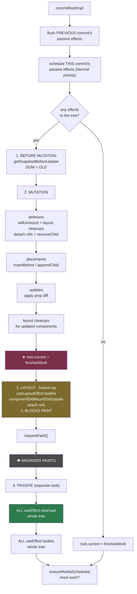

# 08 — The Commit Phase: Three Sub-Phases and Effect Ordering

> **Part 2 · Topic 8** — [index](README.md) · prev: [07 — Complete phase](07-complete-phase.md) · next: [Part 3 — State](../part-3-state/README.md)

The render phase produced a finished tree and a set of flags. Nothing is on
screen yet. Commit makes it real.

**Commit is synchronous, atomic, and uninterruptible.** Once it starts, it runs
to the end. There is no yielding, no priority, no abandoning. The user sees the
old UI, then the new UI, never anything between.

---

## `commitRootImpl` — the skeleton

```js
function commitRootImpl(root, renderPriorityLevel) {

  // 0 ── flush leftovers from the PREVIOUS commit first
  while (rootWithPendingPassiveEffects !== null) {
    flushPassiveEffects();
  }

  const finishedWork = root.finishedWork;
  root.finishedWork = null;

  // schedule this commit's passive effects (they run AFTER paint)
  if ((finishedWork.subtreeFlags & PassiveMask) !== NoFlags ||
      (finishedWork.flags & PassiveMask) !== NoFlags) {
    if (!rootDoesHavePassiveEffects) {
      rootDoesHavePassiveEffects = true;
      scheduleCallback(NormalSchedulerPriority, () => {
        flushPassiveEffects();
        return null;
      });
    }
  }

  const subtreeHasEffects = (finishedWork.subtreeFlags & (BeforeMutationMask |
                             MutationMask | LayoutMask | PassiveMask)) !== NoFlags;
  const rootHasEffect     = (finishedWork.flags & (...)) !== NoFlags;

  if (subtreeHasEffects || rootHasEffect) {

    // 1 ── BEFORE MUTATION  (DOM is still OLD)
    commitBeforeMutationEffects(root, finishedWork);

    // 2 ── MUTATION  (DOM changes here)
    commitMutationEffects(root, finishedWork, lanes);

    root.current = finishedWork;          // ★★★ THE TREE SWAP (Topic 05)

    // 3 ── LAYOUT  (DOM is NEW, browser has NOT painted)
    commitLayoutEffects(finishedWork, root, lanes);

    requestPaint();                       // tell the scheduler: let the browser draw
  } else {
    root.current = finishedWork;          // nothing to do — just swap
  }

  rootWithPendingPassiveEffects = rootDoesHavePassiveEffects ? root : null;

  ensureRootIsScheduled(root);            // more work queued? schedule it
  flushSyncCallbacks();
}
```

Note the first thing it does: **flush the previous commit's passive effects.**
That is the guarantee that `useEffect` from render N always completes before
render N+1's commit — even if the browser never gave React an idle moment.

---

## The timeline

```
 ┌─────────────────────────────────────────────────────────────────────┐
 │                    COMMIT  (synchronous, blocking)                  │
 ├─────────────────────────────────────────────────────────────────────┤
 │                                                                     │
 │  1. BEFORE MUTATION          DOM = OLD                              │
 │     • getSnapshotBeforeUpdate()                                     │
 │       (read scroll position, measure, …)                            │
 │                                                                     │
 │  2. MUTATION                 DOM = CHANGING                         │
 │     • deletions      → componentWillUnmount                         │
 │                        useLayoutEffect CLEANUPS                     │
 │                        detach refs → removeChild                    │
 │     • placements     → insertBefore / appendChild                   │
 │     • updates        → set props / textContent                      │
 │     • useLayoutEffect cleanups for UPDATED components               │
 │     • detach changed refs (ref.current = null)                      │
 │                                                                     │
 │     ★ root.current = finishedWork        ← THE SWAP                 │
 │                                                                     │
 │  3. LAYOUT                   DOM = NEW, NOT YET PAINTED             │
 │     • useLayoutEffect bodies           ⚠ BLOCKS PAINT               │
 │     • componentDidMount / componentDidUpdate                        │
 │     • this.setState(x, callback) callbacks                          │
 │     • attach refs (ref.current = node)                              │
 │                                                                     │
 └─────────────────────────────────┬───────────────────────────────────┘
                                   ▼
 ┌─────────────────────────────────────────────────────────────────────┐
 │  BROWSER:  style → layout → paint → composite                       │
 │  👁 the user finally sees the change                                │
 └─────────────────────────────────┬───────────────────────────────────┘
                                   ▼
 ┌─────────────────────────────────────────────────────────────────────┐
 │  4. PASSIVE  (async — a separate scheduler task)                    │
 │     • ALL useEffect cleanups   (whole tree)                         │
 │     • ALL useEffect bodies     (whole tree)                         │
 └─────────────────────────────────────────────────────────────────────┘
```

---

## Sub-phase 1 — Before mutation

Short. One real job: let code read the DOM **while it is still the old one**.

```js
case ClassComponent: {
  if (finishedWork.flags & Snapshot) {
    const prevProps = current.memoizedProps;
    const prevState = current.memoizedState;
    const instance  = finishedWork.stateNode;
    const snapshot  = instance.getSnapshotBeforeUpdate(prevProps, prevState);
    instance.__reactInternalSnapshotBeforeUpdate = snapshot;   // handed to componentDidUpdate
  }
}
```

The classic use: a chat window that should keep its scroll position when messages
are prepended. You must measure `scrollHeight` **before** the new messages are
inserted, and restore **after**. That's `getSnapshotBeforeUpdate` →
`componentDidUpdate(prevProps, prevState, snapshot)`.

> There is no hook equivalent. `useLayoutEffect` runs *after* mutation. If you
> need a true pre-mutation read, a class component is still the only way.

---

## Sub-phase 2 — Mutation

Where the DOM actually changes. Order within this phase matters a lot.

### Deletions come first

```js
function commitDeletionEffectsOnFiber(root, returnFiber, deletedFiber) {
  switch (deletedFiber.tag) {
    case FunctionComponent: {
      const updateQueue = deletedFiber.updateQueue;
      if (updateQueue !== null) {
        let effect = updateQueue.lastEffect.next;
        do {
          const { destroy, tag } = effect;
          if (destroy !== undefined) {
            if (tag & HookInsertion)   safelyCallDestroy(...);
            else if (tag & HookLayout) safelyCallDestroy(...);   // ← layout cleanup
          }
          effect = effect.next;
        } while (effect !== firstEffect);
      }
      break;
    }
    case ClassComponent: {
      safelyDetachRef(deletedFiber, nearestMountedAncestor);
      safelyCallComponentWillUnmount(deletedFiber, ...);
      break;
    }
    case HostComponent: {
      safelyDetachRef(deletedFiber, nearestMountedAncestor);
      break;
    }
  }
  // recurse into children, then finally remove the top host node from the DOM
}
```

Two things to notice:

**① It recurses into the whole deleted subtree.** Deleting one node runs cleanup
for every descendant — every `componentWillUnmount`, every layout cleanup, every
ref detach — *before* a single `removeChild`.

**② Only `Insertion` and `Layout` cleanups run here.** `useEffect` (passive)
cleanups for a deleted tree are **not** run in mutation; they run later in the
passive phase. React keeps the deleted fibers alive until then specifically so it
can call them.

> This is why a `useLayoutEffect` cleanup on an unmounting component can still
> read the DOM node, but a `useEffect` cleanup sometimes cannot — by the time it
> runs, the node is gone from the document.

### Then placements and updates

```js
if (flags & Placement) commitPlacement(finishedWork);   // insertBefore / appendChild
if (flags & Update)    commitUpdate(instance, updatePayload, ...);  // apply the diff
if (flags & Ref)       safelyDetachRef(current, ...);   // old ref → null
```

`commitUpdate` is the cheap half of the work from Topic 07 — loop the payload
array in pairs and write:

```js
for (let i = 0; i < updatePayload.length; i += 2) {
  const propKey = updatePayload[i];
  const propValue = updatePayload[i + 1];
  // setAttribute / set property / set textContent / merge style
}
```

### Refs are detached here, attached later

```
   MUTATION:  ref.current = null         ← old value cleared
   LAYOUT:    ref.current = newNode      ← new value set
```

That gap is deliberate: between them, the DOM is changing. React guarantees you
never observe a ref pointing at a node that has just been removed.

It's also why a callback ref fires **twice** when its dependencies change —
once with `null` (detach, mutation) and once with the node (attach, layout). And
why an inline arrow callback ref (`ref={el => ...}`) fires on every render: new
function identity → React treats it as a changed ref → detach + attach.

### Then the swap

```js
root.current = finishedWork;
```

Positioned exactly here (Topic 05): unmount code above it still sees the old tree
as current; layout code below it sees the new one.

---

## Sub-phase 3 — Layout

The DOM is new. **The browser has not painted yet.** Everything here is blocking.

```js
case FunctionComponent:
  commitHookEffectListMount(HookLayout | HookHasEffect, finishedWork);  // useLayoutEffect
  break;

case ClassComponent:
  if (current === null) instance.componentDidMount();
  else                  instance.componentDidUpdate(prevProps, prevState, snapshot);
  commitUpdateQueue(finishedWork, updateQueue, instance);   // setState callbacks
  break;

// after the switch, for every tag:
if (flags & Ref) safelyAttachRef(finishedWork, finishedWork.return);
```

### The traversal is bottom-up

Children's layout effects and refs complete **before** the parent's. So inside a
parent's `useLayoutEffect`, every child `ref.current` is already attached. That
ordering is what makes measure-in-layout-effect work at all:

```jsx
function Tooltip() {
  const ref = useRef(null);
  useLayoutEffect(() => {
    const { height } = ref.current.getBoundingClientRect();  // ✅ attached, measurable
    setPosition(anchorTop - height);                         // re-render BEFORE paint
  }, []);
  return <div ref={ref}>…</div>;
}
```

### Why `useLayoutEffect` blocks paint — and why that's the point

```
   useLayoutEffect:   mutate DOM ─ run effect ─ mutate again ─ PAINT
                                                               └─ user sees final result ✅

   useEffect:         mutate DOM ─ PAINT ─ run effect ─ mutate again ─ PAINT
                                    └─ user sees intermediate state ❌ FLICKER
```

If you measure and reposition in `useEffect`, the browser paints the wrong
position first. The flicker is real and visible. `useLayoutEffect` exists purely
so you can mutate between the DOM change and the paint.

The cost is that everything in it is on the critical path. A `setState` inside a
layout effect forces a **synchronous re-render before paint** — correct, but
expensive. That's the trade: use it when you must prevent a flicker, `useEffect`
otherwise.

---

## Sub-phase 4 — Passive effects (`useEffect`)

Scheduled with the Scheduler at Normal priority, so it lands in a separate task —
normally after paint.

```js
function flushPassiveEffectsImpl() {
  // 1. ALL cleanups, whole tree
  commitPassiveUnmountEffects(root.current);

  // 2. ALL setups, whole tree
  commitPassiveMountEffects(root, root.current, lanes);
}
```

### The ordering rule that surprises everyone

> **All cleanups across the entire tree run before any setup runs.**
> Not per component — per tree.

```jsx
<Parent>   {/* useEffect: parent  */}
  <Child/> {/* useEffect: child   */}
</Parent>
```

On an update where both re-run:

```
   1. child  cleanup
   2. parent cleanup      ← ALL cleanups first
   3. child  effect
   4. parent effect       ← then ALL setups
```

**Not** `child cleanup → child effect → parent cleanup → parent effect`.

Why: a parent's cleanup might tear down something a child's new effect wants to
use. Running them interleaved would let a component observe a half-torn-down
tree. Batching all destroys first guarantees every effect sets up against a
consistent world.

### "`useEffect` runs after paint" is the usual case, not a guarantee

React force-flushes passive effects early when correctness demands it:

- at the top of the **next** `commitRootImpl` (see step 0)
- before processing a **discrete event** (click, keydown)
- on `flushSync`

So the real guarantee is: *effects from render N always complete before anything
that could depend on them.* Usually that's after paint; under pressure it's
sooner.

### StrictMode double-invokes effects

In development, React 18+ mounts, runs effects, **runs cleanups, runs effects
again**:

```
   mount → effect → cleanup → effect
```

This simulates a future where React may unmount and remount a subtree while
preserving state (Offscreen / `<Activity>`). It surfaces effects that aren't
cleanup-safe — the subscription you never unsubscribed, the timer you never
cleared. If your effect breaks under it, it has a real bug.

---

## The complete order, one list

For a tree where everything changed:

```
    ── RENDER PHASE (interruptible) ──
 1. your component functions run
 2. DOM nodes created (detached), prop diffs computed

    ── COMMIT (synchronous) ──
 3. getSnapshotBeforeUpdate                      (old DOM)
 4. componentWillUnmount          ─┐
 5. useLayoutEffect cleanups       │ deleted subtrees, deepest first
 6. refs detached (= null)        ─┘
 7. DOM mutations: remove / insert / update props
 8. useLayoutEffect cleanups for UPDATED components
 9. ★ root.current = finishedWork
10. useLayoutEffect bodies        ─┐
11. componentDidMount/DidUpdate    │ children before parents
12. setState callbacks             │
13. refs attached                 ─┘

    ── BROWSER ──
14. 👁 PAINT

    ── PASSIVE (async task) ──
15. ALL useEffect cleanups   (whole tree)
16. ALL useEffect bodies     (whole tree)
```

Memorise 3 → 16 and most "why did this fire before that?" questions answer
themselves.

---

## The phase as a diagram



---

## 🔧 Hands-on

Prove the ordering yourself:

```jsx
function Child() {
  useLayoutEffect(() => { console.log('3 child layout');
                   return () => console.log('child layout cleanup'); });
  useEffect(() => { console.log('5 child passive');
             return () => console.log('child passive cleanup'); });
  return <div ref={() => console.log('2 child ref')} />;
}

function Parent() {
  useLayoutEffect(() => console.log('4 parent layout'));
  useEffect(() => console.log('6 parent passive'));
  return <Child />;
}
```

Mount output: child ref → child layout → parent layout → **paint** → child
passive → parent passive. Children always before parents.

Now see the flicker difference — swap `useLayoutEffect` for `useEffect` here:

```jsx
const ref = useRef();
useLayoutEffect(() => { ref.current.style.transform = 'translateX(300px)'; });
return <div ref={ref} style={{ width: 50, height: 50, background: 'red' }} />;
```

With `useLayoutEffect`: the box only ever appears at 300px. With `useEffect`:
it paints at 0 first, then jumps. That one swap is the whole difference between
the two hooks.

---

## Key takeaways

- Commit is **synchronous, atomic, uninterruptible**, and runs exactly once.
- **Three sub-phases**: before-mutation (old DOM), mutation (DOM changes, then
  the tree swap), layout (new DOM, pre-paint) — plus passive effects after paint.
- The first thing a commit does is **flush the previous commit's passive effects**.
- Deletions run first and recurse the whole subtree: unmount, layout cleanups,
  ref detach — all before any `removeChild`.
- Only **layout** cleanups run at deletion time; **passive** cleanups for deleted
  trees run later, which is why a `useEffect` cleanup may find the node gone.
- Refs are **detached in mutation, attached in layout** — hence callback refs
  firing twice, and inline arrow refs firing every render.
- Layout effects run **bottom-up**, so child refs are attached before a parent
  measures.
- `useLayoutEffect` **blocks paint** — that's a cost *and* the entire reason it
  exists (no flicker when you measure-then-mutate).
- In the passive phase, **every cleanup in the tree runs before any setup**.
- "After paint" is the usual timing for `useEffect`, not a guarantee — React
  flushes early whenever correctness requires it.

---

## 🏁 Part 2 complete

You now have the full pipeline:

```
 Elements → beginWork (diff) → completeWork (build + summarise) → commit (apply)
     02           06                     07                          08
                   ▲                      ▲
            fiber node 04          double buffering 05
```

**Part 3** goes inside one field we kept deferring: `memoizedState` on a function
component — the hooks linked list, the dispatcher, and why `setState` behaves the
way it does.

> next: [Part 3 — State](../part-3-state/README.md)
