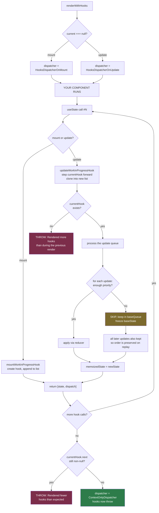

# 09 — Hooks Internals: The Linked List and the Dispatcher

> **Part 3 · Topic 9** — [index](README.md) · prev: [08 — Commit phase](../part-2-fiber-engine/08-commit-phase.md) · next: 10 — Updates & batching

We have deferred one field four times now: `fiber.memoizedState` on a function
component. This is that field.

By the end of this file, the Rules of Hooks will not be a rule you follow. It
will be a **consequence you can derive**.

---

## The problem hooks had to solve

A class component has an instance. State has an obvious home:

```js
class Counter extends Component {
  state = { n: 0 };     // lives on `this` — the fiber's stateNode
}
```

A function component has nothing:

```js
function Counter() {
  const [n, setN] = useState(0);   // where does `0` live between renders?
  return <span>{n}</span>;
}
```

The function runs, returns, and every local variable is gone. `stateNode` is
`null` (Topic 04). There is no `this`.

Two questions to answer:

1. **Where is the value stored?** → on the fiber, in `memoizedState`.
2. **How does React know which `useState` call is which?** → by **call order**.
   Nothing else.

That second answer is the whole topic.

---

## Part 1 — The Hook object

```js
const hook = {
  memoizedState: null,   // the current value
  baseState:     null,   // the value before any skipped updates
  baseQueue:     null,   // updates that were skipped and must be replayed
  queue:         null,   // the update queue for this hook
  next:          null,   // ← THE LINKED LIST
};
```

And on the fiber:

```js
fiber.memoizedState ──► hook1 ──next──► hook2 ──next──► hook3 ──► null
```

```jsx
function Profile() {
  const [name, setName] = useState('Ada');   // hook1
  const [age,  setAge]  = useState(36);      // hook2
  const ref             = useRef(null);      // hook3
  useEffect(() => {}, []);                   // hook4
}
```

```
 fiber.memoizedState
        │
        ▼
 ┌──────────────┐   ┌──────────────┐   ┌──────────────┐   ┌──────────────┐
 │ memoized:    │   │ memoized:    │   │ memoized:    │   │ memoized:    │
 │   'Ada'      │──►│   36         │──►│ {current:    │──►│ {create,     │──► null
 │ queue: {…}   │   │ queue: {…}   │   │   null}      │   │  deps:[], …} │
 └──────────────┘   └──────────────┘   └──────────────┘   └──────────────┘
    useState            useState           useRef             useEffect
```

> **Look at what is missing: names.**
> There is no `"name"`, no `"age"`, no identifier of any kind. Hook 3 is found by
> starting at the head and following `next` three times.
>
> **Position is identity. That is the entire mechanism.**

---

## Part 2 — The dispatcher

`useState` in the `react` package does almost nothing:

```js
// packages/react/src/ReactHooks.js
export function useState(initialState) {
  const dispatcher = resolveDispatcher();
  return dispatcher.useState(initialState);
}

function resolveDispatcher() {
  return ReactCurrentDispatcher.current;    // a shared mutable slot
}
```

`ReactCurrentDispatcher` lives in `ReactSharedInternals` — a module both `react`
and the reconciler import. It is, bluntly, **a global variable both packages
agree to use**.

### Four dispatchers

| Dispatcher | Installed when | `useState` does |
|---|---|---|
| `HooksDispatcherOnMount` | first render of this fiber | **creates** a hook, appends to the list |
| `HooksDispatcherOnUpdate` | re-render | **walks** to the next existing hook |
| `HooksDispatcherOnRerender` | `setState` called during render | re-applies render-phase updates |
| `ContextOnlyDispatcher` | **not rendering** | **throws** |

The swap happens in `renderWithHooks` (we saw it in Topic 06):

```js
ReactCurrentDispatcher.current =
  (current === null || current.memoizedState === null)
    ? HooksDispatcherOnMount
    : HooksDispatcherOnUpdate;

let children = Component(props);           // ◄── your function

ReactCurrentDispatcher.current = ContextOnlyDispatcher;
```

### This explains two errors exactly

**"Invalid hook call. Hooks can only be called inside the body of a function
component."**

```js
export const ContextOnlyDispatcher = {
  useState:  throwInvalidHookError,
  useEffect: throwInvalidHookError,
  useRef:    throwInvalidHookError,
  // ...every hook
};
```

Outside a render, the slot holds this object. Every hook on it throws. There is
no clever detection — the error *is* the default state.

**Two copies of React in `node_modules`**

```
   react (copy A)                   react (copy B)
   ReactCurrentDispatcher.current   ReactCurrentDispatcher.current
             ▲                                 ▲
             │ reconciler fills THIS one       │ your component reads THIS one
                                                 (still ContextOnlyDispatcher)
```

Two module instances, two separate slots. The reconciler fills one; your
component reads the other and gets the throwing dispatcher. Same error message,
completely different cause — which is why the React docs list three unrelated
reasons for it.

---

## Part 3 — Mount: building the list

```js
function mountWorkInProgressHook() {
  const hook = {
    memoizedState: null, baseState: null,
    baseQueue: null, queue: null, next: null,
  };

  if (workInProgressHook === null) {
    currentlyRenderingFiber.memoizedState = workInProgressHook = hook;   // first
  } else {
    workInProgressHook = workInProgressHook.next = hook;                 // append
  }
  return workInProgressHook;
}
```

Two module-level cursors do all the bookkeeping:

```js
let currentlyRenderingFiber = null;   // whose hooks are we building
let workInProgressHook = null;        // the hook we just created
let currentHook = null;               // the matching hook in the OLD list
```

### `mountState`

```js
function mountState(initialState) {
  const hook = mountWorkInProgressHook();

  if (typeof initialState === 'function') {
    initialState = initialState();        // ← lazy initialiser, MOUNT ONLY
  }
  hook.memoizedState = hook.baseState = initialState;

  const queue = {
    pending: null,
    lanes: NoLanes,
    dispatch: null,
    lastRenderedReducer: basicStateReducer,
    lastRenderedState: initialState,
  };
  hook.queue = queue;

  const dispatch = queue.dispatch =
    dispatchSetState.bind(null, currentlyRenderingFiber, queue);   // ★

  return [hook.memoizedState, dispatch];
}
```

Two facts fall out of that last line:

**① The setter's identity is stable forever.** It is created once, at mount, and
returned unchanged on every subsequent render. That's why `setCount` is safe to
omit from a dependency array.

**② The setter is bound to the fiber and the queue.** It doesn't need to be
"inside" a render to work — it already knows where to put the update. That's why
you can call it from a timeout, a promise, or an event handler.

> Bound to *which* fiber, though? The trees alternate (Topic 05). React handles
> it: `markUpdateLaneFromFiberToRoot` sets the lane on **both** `fiber` and
> `fiber.alternate`, so whichever one is current picks it up.

### `useState` is `useReducer`

```js
function basicStateReducer(state, action) {
  return typeof action === 'function' ? action(state) : action;
}
```

That is the **complete** implementation difference between `useState` and
`useReducer`. `useState(x)` is `useReducer(basicStateReducer, x)`.

And that one `typeof` check is the entire difference between:

```js
setCount(5)              // action = 5        → returns 5
setCount(c => c + 1)     // action = function → returns action(state)
```

---

## Part 4 — Update: walking the list

```js
function updateWorkInProgressHook() {
  let nextCurrentHook;
  if (currentHook === null) {
    const current = currentlyRenderingFiber.alternate;
    nextCurrentHook = current !== null ? current.memoizedState : null;  // head
  } else {
    nextCurrentHook = currentHook.next;                                  // step
  }

  if (nextCurrentHook === null) {
    throw new Error('Rendered more hooks than during the previous render.');
  }

  currentHook = nextCurrentHook;

  const newHook = {                            // clone into the WIP list
    memoizedState: currentHook.memoizedState,
    baseState:     currentHook.baseState,
    baseQueue:     currentHook.baseQueue,
    queue:         currentHook.queue,          // ← queue object is SHARED
    next:          null,
  };

  if (workInProgressHook === null) {
    currentlyRenderingFiber.memoizedState = workInProgressHook = newHook;
  } else {
    workInProgressHook = workInProgressHook.next = newHook;
  }
  return workInProgressHook;
}
```

**Two lists walk in lockstep:** `currentHook` steps through the old list,
`workInProgressHook` builds the new one. Each hook call advances both by one.

```
   OLD (current.memoizedState)      NEW (wip.memoizedState)

   hook1 ──► hook2 ──► hook3        hook1' ──► hook2' ──► hook3'
     ▲                                 ▲
  currentHook                   workInProgressHook
     │                                 │
     └──── both advance by exactly one per hook call ────┘
```

The pairing is purely **positional**. Call #2 gets old-hook #2. Always.

---

## Part 5 — The Rules of Hooks, derived

Now the proof.

```jsx
function Bad({ loggedIn }) {
  if (loggedIn) {
    const [name, setName] = useState('Ada');   // call 1 — conditional
  }
  const [theme, setTheme] = useState('dark');  // call 2 (or 1)
  const [lang,  setLang]  = useState('en');    // call 3 (or 2)
}
```

**Render 1 — `loggedIn = true`.** Mount builds:

```
   position 1 ──► 'Ada'
   position 2 ──► 'dark'
   position 3 ──► 'en'
```

**Render 2 — `loggedIn = false`.** Only two hook calls happen:

```
   YOUR CALL                  GETS POSITION     VALUE IT RECEIVES
   useState('dark')    ───►   position 1   ───►   'Ada'    ❌
   useState('en')      ───►   position 2   ───►   'dark'   ❌
                              position 3 never visited
```

```jsx
theme === 'Ada'    // 🤯
lang  === 'dark'
```

And at the end of `renderWithHooks`:

```js
const didRenderTooFewHooks = currentHook !== null && currentHook.next !== null;
if (didRenderTooFewHooks) {
  throw new Error('Rendered fewer hooks than expected. This may be caused by an ' +
                  'accidental early return statement.');
}
```

The reverse case — a condition that *adds* a hook — hits the other throw in
`updateWorkInProgressHook`: *"Rendered more hooks than during the previous
render."*

### The rule, restated honestly

> ❌ "Don't call hooks conditionally."
> ✅ "**The number and order of hook calls must be identical on every render**,
> because position is the only identity a hook has."

Which immediately tells you what's actually allowed:

```jsx
// ✅ fine — the count is constant
for (let i = 0; i < 3; i++) useEffect(() => {}, []);

// ✅ fine — early return BEFORE any hook (no list was started)
if (!data) return null;
const [x] = useState(0);        // ...but fragile; one edit above breaks it

// ❌ broken — count varies
items.map(() => useState(0));

// ❌ broken — early return BETWEEN hooks
const [a] = useState(0);
if (!data) return null;
const [b] = useState(0);
```

And why the linter rule is purely syntactic: it can't evaluate your conditions,
so it enforces the safe syntactic subset — top level of a component or another hook.

---

## Part 6 — `dispatchSetState`: what `setCount` actually does

```js
function dispatchSetState(fiber, queue, action) {
  const lane = requestUpdateLane(fiber);

  const update = {
    lane,
    action,
    hasEagerState: false,
    eagerState: null,
    next: null,
  };

  if (isRenderPhaseUpdate(fiber)) {
    enqueueRenderPhaseUpdate(queue, update);          // setState during render
  } else {
    const alternate = fiber.alternate;

    if (fiber.lanes === NoLanes &&
        (alternate === null || alternate.lanes === NoLanes)) {
      // ★ EAGER STATE — no pending updates, so we can compute the result NOW
      const lastRenderedReducer = queue.lastRenderedReducer;
      if (lastRenderedReducer !== null) {
        const currentState = queue.lastRenderedState;
        const eagerState = lastRenderedReducer(currentState, action);

        update.hasEagerState = true;
        update.eagerState = eagerState;

        if (is(eagerState, currentState)) {
          enqueueConcurrentHookUpdateAndEagerlyBailout(fiber, queue, update);
          return;                      // ◄── NOTHING IS SCHEDULED. AT ALL.
        }
      }
    }

    const root = enqueueConcurrentHookUpdate(fiber, queue, update, lane);
    if (root !== null) {
      scheduleUpdateOnFiber(root, fiber, lane);
    }
  }
}
```

### The eager bailout

```jsx
const [n, setN] = useState(0);
<button onClick={() => setN(0)}>   {/* no render. no scheduling. nothing. */}
```

React computes `basicStateReducer(0, 0) → 0`, compares with `Object.is`, sees no
change, and returns. This is bailout ① from Topic 06 — the cheapest one.

> **Why only when `fiber.lanes === NoLanes`?** If updates are already queued,
> React doesn't know what the current state *will be* by the time this one
> applies, so the eager computation would be wrong. It only short-circuits when
> the queue is empty.
>
> **Caveat:** React may still render that component **once more** before settling.
> The bailout prevents the *scheduling*, not every possible subsequent render.

### The update queue is circular, and `pending` points to the LAST

```js
if (queue.pending === null) {
  update.next = update;                    // a ring of one
} else {
  update.next = queue.pending.next;        // new.next = first
  queue.pending.next = update;             // last.next = new
}
queue.pending = update;                    // new is the last
```

```
     queue.pending
           │
           ▼
         ┌───┐     ┌───┐     ┌───┐
    ┌───►│ A │────►│ B │────►│ C │───┐
    │    └───┘     └───┘     └───┘   │
    └────────────────────────────────┘
    pending = C  (last)
    pending.next = A  (first)
```

Why last-pointer + circular? **O(1) append** *and* **O(1) access to the head**,
with one pointer. A head-pointer list would need O(n) to append; two pointers
would be more to keep in sync.

---

## Part 7 — Processing the queue: `baseState` and `baseQueue`

This is the subtlest machinery in React, and it exists for exactly one reason:
**a low-priority update can be skipped, and must still apply later — in the
right order.**

```js
function updateReducer(reducer, initialArg, init) {
  const hook = updateWorkInProgressHook();
  const queue = hook.queue;
  queue.lastRenderedReducer = reducer;

  let baseQueue = currentHook.baseQueue;
  const pendingQueue = queue.pending;
  if (pendingQueue !== null) {
    /* splice pending into baseQueue */
    currentHook.baseQueue = baseQueue = pendingQueue;
    queue.pending = null;
  }

  if (baseQueue !== null) {
    const first = baseQueue.next;
    let newState = currentHook.baseState;
    let newBaseState = null, newBaseQueueFirst = null, newBaseQueueLast = null;
    let update = first;

    do {
      if (!isSubsetOfLanes(renderLanes, update.lane)) {
        // ── SKIP: not enough priority for this update right now
        const clone = { lane: update.lane, action: update.action, next: null, ... };
        if (newBaseQueueLast === null) {
          newBaseQueueFirst = newBaseQueueLast = clone;
          newBaseState = newState;          // ← freeze the base HERE
        } else {
          newBaseQueueLast = newBaseQueueLast.next = clone;
        }
        currentlyRenderingFiber.lanes = mergeLanes(currentlyRenderingFiber.lanes, update.lane);
      } else {
        // ── APPLY
        if (newBaseQueueLast !== null) {
          // we already skipped one, so this one must be REPLAYED later too
          const clone = { lane: NoLane, action: update.action, next: null, ... };
          newBaseQueueLast = newBaseQueueLast.next = clone;
        }
        newState = update.hasEagerState
          ? update.eagerState
          : reducer(newState, update.action);
      }
      update = update.next;
    } while (update !== null && update !== first);

    hook.memoizedState = newState;      // what this render shows
    hook.baseState     = newBaseState;  // where a replay would start
    hook.baseQueue     = newBaseQueueLast;
    queue.lastRenderedState = newState;
  }

  return [hook.memoizedState, queue.dispatch];
}
```

### Worked example

State is `0`. Two updates arrive:

```
   A = +1  at Transition (low) priority
   B = +10 at Sync (high) priority
```

A high-priority render happens first, with `renderLanes = Sync`:

```
   baseState = 0,  queue = [A(low), B(sync)]

   update A: low ⊄ Sync  → SKIP
             clone A into baseQueue
             newBaseState = 0            ← frozen before A
   update B: sync ⊆ Sync → APPLY
             but baseQueue is non-empty, so clone B too (lane = NoLane)
             newState = 0 + 10 = 10

   ► memoizedState = 10      ← the user sees 10 immediately
   ► baseState     = 0
   ► baseQueue     = [A, B]  ← both kept
```

Later, the low-priority render runs with `renderLanes` including Transition:

```
   start from baseState = 0
   apply A → 1
   apply B → 11

   ► memoizedState = 11      ← correct final value, correct order
```

```
   time ──────────────────────────────────────────────►
   state shown:   0 ──────► 10 ──────────────► 11
                      ▲                 ▲
              urgent update applied   low-priority
              immediately             replayed in order
```

**Why clone B even though it was applied?** Because the replay must produce the
same *order*. If B were dropped from the queue, the later pass would compute
`0 + 1 = 1` and the +10 would be lost. Once one update is skipped, **every
update after it must be retained**.

That is the guarantee: *state is always derived by applying updates in their
original order, no matter how many times rendering was interrupted.*

---

## Part 8 — The other hooks (they're all small)

### `useRef`

```js
function mountRef(initialValue) {
  const hook = mountWorkInProgressHook();
  hook.memoizedState = { current: initialValue };
  return hook.memoizedState;
}

function updateRef() {
  return updateWorkInProgressHook().memoizedState;   // the SAME object
}
```

That's the whole hook. One object, created once, returned forever. Mutating
`.current` touches no React machinery — which is exactly why it doesn't
re-render, and why it's the escape hatch for mutable values.

### `useMemo`

```js
function updateMemo(nextCreate, deps) {
  const hook = updateWorkInProgressHook();
  const prevState = hook.memoizedState;              // [value, deps]

  if (prevState !== null && deps !== null) {
    if (areHookInputsEqual(deps, prevState[1])) {
      return prevState[0];                           // cache hit
    }
  }
  const nextValue = nextCreate();
  hook.memoizedState = [nextValue, deps];
  return nextValue;
}
```

`useCallback` is identical, storing the function instead of its result.

### `areHookInputsEqual`

```js
function areHookInputsEqual(nextDeps, prevDeps) {
  if (prevDeps === null) return false;              // no deps → always re-run
  for (let i = 0; i < prevDeps.length && i < nextDeps.length; i++) {
    if (is(nextDeps[i], prevDeps[i])) continue;
    return false;
  }
  return true;
}
```

`Object.is`, index by index. **That is why `deps: [{a:1}]` never matches** — a new
object literal is a new reference every render.

> **`useMemo` is a hint, not a guarantee.** React is documented as free to throw
> away memoized values (e.g. to free memory for offscreen content). Never put
> something *required for correctness* in `useMemo`.

### `useEffect`

```js
function pushEffect(tag, create, destroy, deps) {
  const effect = { tag, create, destroy, deps, next: null };
  // appended to a CIRCULAR list on fiber.updateQueue
}

function updateEffectImpl(fiberFlags, hookFlags, create, deps) {
  const hook = updateWorkInProgressHook();
  const prevEffect = currentHook.memoizedState;
  const destroy = prevEffect.destroy;

  if (deps !== null && areHookInputsEqual(deps, prevEffect.deps)) {
    hook.memoizedState = pushEffect(hookFlags, create, destroy, deps);
    return;                                  // ← stored, but NOT tagged HasEffect
  }

  currentlyRenderingFiber.flags |= fiberFlags;          // Passive
  hook.memoizedState = pushEffect(HookHasEffect | hookFlags, create, destroy, deps);
}
```

Note the shape: the effect is **always** pushed to the list — only the
`HookHasEffect` tag differs. The commit phase walks the list and fires only the
tagged ones. The list must stay complete because, like hooks, **effects are
matched positionally**.

---

## Part 9 — Stale closures, explained properly

Not a bug. A direct consequence of "each render is a separate function call".

```jsx
function Timer() {
  const [count, setCount] = useState(0);

  useEffect(() => {
    const id = setInterval(() => {
      console.log(count);     // ← always 0
      setCount(count + 1);    // ← always 0 + 1
    }, 1000);
    return () => clearInterval(id);
  }, []);                     // ← captured the FIRST render's `count`
}
```

```
   render 0: const count = 0  →  the interval callback closes over THIS `count`
   render 1: const count = 1  →  a different variable, in a different call frame
   render 2: const count = 2  →  the interval is still holding render 0's
```

`count` is a `const` in a function that already returned. The closure is doing
exactly what JavaScript closures do. React cannot and does not reach into it.

Three fixes, each targeting a different part of the mechanism:

```jsx
setCount(c => c + 1);     // ① don't read state — let the reducer read it
                          //    (the queue applies against the live value)

}, [count]);              // ② re-create the effect so it closes over a fresh value

const ref = useRef(count);// ③ read through a stable mutable box
ref.current = count;      //    (the same object across all renders)
```

---

## The whole flow



---

## 🔧 Hands-on: read the hook list from the console

```js
const el    = document.querySelector('#root > *');
const key   = Object.keys(el).find(k => k.startsWith('__reactFiber$'));
let fiber   = el[key];
while (fiber && typeof fiber.type !== 'function') fiber = fiber.return;  // find a component

let hook = fiber.memoizedState, i = 0;
while (hook) {
  console.log(`hook ${i++}:`, hook.memoizedState);
  hook = hook.next;
}
```

You will see your state values, your refs (`{current: …}`), your memo entries
(`[value, deps]`), and your effects — **in source order, with no names**. Seeing
that output once makes the Rules of Hooks permanently obvious.

---

## Key takeaways

- A function component's state lives on its fiber, in `memoizedState`, as a
  **singly linked list of hook objects with no names**.
- **Position is identity.** Hook #3 is "follow `next` three times". Nothing else.
- The Rules of Hooks are not a convention — they are the precondition for that
  lookup to be correct. Both React error messages come from the two ways it breaks.
- Hooks reach the reconciler through a **mutable dispatcher slot**; the
  not-rendering default is a dispatcher where every hook throws, which is
  literally "Invalid hook call".
- `useState` is `useReducer` with a 1-line reducer; that line is the whole
  difference between `setX(v)` and `setX(prev => …)`.
- The setter is **bound at mount** to the fiber + queue, so its identity is stable
  and it works from anywhere.
- `dispatchSetState` can bail out **before scheduling anything** when the state is
  unchanged and the queue is empty.
- The update queue is **circular with a pointer to the last** node: O(1) append
  and O(1) head access.
- `baseState` / `baseQueue` exist so a skipped low-priority update can be
  **replayed later in its original order** — the guarantee that makes concurrent
  rendering safe.
- `useRef` is one object returned forever; `useMemo`/`useCallback` are
  `[value, deps]` plus an `Object.is` loop.
- Stale closures are plain JavaScript closures over a `const` in a returned
  function — exactly what you'd expect once you see that each render is its own call.

---

> next: **10 — Updates & batching**: how `setState` schedules, why React 18
> batches everywhere, and what `flushSync` really does.
